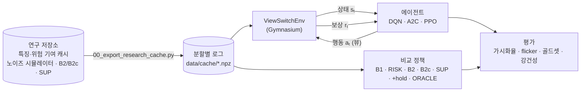

<div align="center">

# 🎛️ RL Camera View Switching

**원격주행 관제를 위한 강화학습 기반 카메라 뷰 전환 정책**


> 매 순간 "가장 중요한 뷰"를 고르는 것과, **화면을 너무 자주 바꾸지 않으면서** 위험을 놓치지 않는 것은 다른 문제입니다.<br/>
> 뒤쪽 문제를 순차 의사결정으로 보고, 강화학습으로 전환 정책을 학습합니다.

</div>

> [!NOTE]
> [Adaptive-Camera-View-Selection-System](https://github.com/cbnu-yhjeon/Adaptive-Camera-View-Selection-System)(지도학습 모델, 이하 **연구 저장소**)의 후속 실험입니다.
> 환경·에이전트·평가·실험이 모두 구현되어 있고, 결과는 [`results/report.md`](results/report.md)에 자동 생성됩니다.

---

## 📌 문제 정의

연구 저장소의 지도학습 모델은 프레임마다 최적 뷰를 예측하고, 화면 깜빡임(flicker)은 손실 함수의 temporal consistency 항으로 억제합니다.
하지만 "지금 바꾸면 2초 뒤 더 위험한 객체를 놓칠 수 있다" 같은 **장기적인 득실**은 프레임 단위 분류로 직접 최적화되지 않습니다.

## 💡 핵심 아이디어: 로그로 정확하게 재생되는 MDP

뷰 선택은 **오퍼레이터가 무엇을 보는지만 바꾸고, 차량과 주변 세계에는 영향을 주지 않습니다.** 그래서 주행 로그만으로 환경을 정확히 재현할 수 있습니다.

| 요소 | 정의 (구현: [`src/env/view_switch_env.py`](src/env/view_switch_env.py)) |
|---|---|
| 상태 `sₜ` | 주행 컨텍스트 `xₜ`(과거 2초 = 4 keyframe의 채널별 영상 특징·위험도 벡터·CAN) + 표시 상태 `vₜ₋₁` + 마지막 전환 후 경과 시간 |
| 행동 `aₜ` | 6채널 중 하나. 주 뷰(진행 방향)는 연구 저장소처럼 상시 표시이므로, **진행 방향 채널을 고르면 '보조 뷰 없음'** |
| 전이 | `xₜ₊₁`은 로그에서 그대로 읽음(행동과 무관), `vₜ = aₜ` |
| 보상 `rₜ` | `w_risk · Σ_{i ∈ view(aₜ)} w(TTCᵢ)  −  λ_sw · 1[vₜ ≠ vₜ₋₁]  −  λ_miss · 1[위험 객체가 화면 밖]` |

- 세계의 전이가 행동과 무관하므로, 로그 재생 환경에서의 온라인 RL이 **시뮬레이터 오차 없이** 성립합니다.
  같은 이유로 GT·미래를 알면 최적 행동열을 **동적 계획법으로 정확히** 풀 수 있어(`dp_oracle`), 보상의 상한(ORACLE)을 표에 함께 싣습니다.
- 전환 비용 `λ_sw`가 0이면 문제는 매 프레임 독립적인 선택(contextual bandit)이 됩니다. **RL이 의미를 갖는 지점은 전환 비용이 있을 때**입니다. 이 점을 실험으로 보여 줍니다(아래 결과).
- 보상은 항상 **GT**(`risk_gt`, GT 위험 판정)로 계산하고, 관측 위험도는 GT 또는 연구 저장소 검출 오류 시뮬레이터의 손상 입력입니다(연구 저장소 원칙 2: 정답은 GT로, 입력은 손상될 수 있다).

---

## 🔗 기반 수업과 저장소

| 수업 / 프로젝트 | 가져온 것 | 저장소 |
|---|---|---|
| 강화학습 | MDP · 벨만 방정식, DQN(Experience Replay, Target Network), Policy Gradient, A2C | [Reinforcement-Learning-Entities](https://github.com/cbnu-yhjeon/Reinforcement-Learning-Entities) |
| 연구: 적응형 카메라 뷰 | nuScenes 특징 캐시, TTC 가중치 `w(TTC)`, 의사 라벨, scene 분할, 평가 지표, 노이즈 강건성 프로토콜, 규칙(B2·B2c)·지도학습(SUP) 출력 | [Adaptive-Camera-View-Selection-System](https://github.com/cbnu-yhjeon/Adaptive-Camera-View-Selection-System) |
| 딥러닝 실체 | 신경망 학습 원리 | [Deep-Learning-Entities](https://github.com/cbnu-yhjeon/Deep-Learning-Entities) |

---

## 🧭 구성



1. **로그 내보내기** — 연구 저장소의 가상환경에서 [`scripts/00_export_research_cache.py`](scripts/00_export_research_cache.py)를 돌려, 연구 저장소의 nuScenes 래퍼·특징 캐시·위험 기여 캐시·노이즈 시뮬레이터·규칙 베이스라인·지도학습 모델을 **그대로 import**해 분할별 배열을 만듭니다. 그래서 이 저장소의 RL은 연구 저장소와 같은 입력·같은 손상·같은 정의를 봅니다. 노이즈 입력은 연구 저장소 평가와 같은 프레임 단위 고정 손상(`frame_risk`)입니다.
2. **환경** — `ViewSwitchEnv`(Gymnasium 표준, scene 하나 = 에피소드 하나)와 학습용 `BatchedViewSwitchEnv`(병렬). 둘은 같은 `_Core`로 관측·보상을 계산하고, 테스트가 동일성을 확인합니다. 연속 scene을 이어 붙이는 `env.concat_scenes` 옵션이 있습니다.
3. **상태 인코더** — 연구 저장소 제안 모델의 구조(채널 토큰 + CAN 토큰 → Transformer → 채널별 GRU)를 재사용하고, 표시 상태·진행 방향·경과 시간을 채널별 특징으로 붙입니다. 행동 a = 채널 a이므로 Q값·logit은 **채널 공유 헤드**에서 나옵니다([`src/encoders/state_encoder.py`](src/encoders/state_encoder.py)).
4. **에이전트** — DQN(Double DQN, Experience Replay, soft Target Network), A2C, PPO를 직접 구현했습니다([`src/agents/`](src/agents/)). 리플레이 버퍼와 롤아웃은 관측 대신 **상태 인덱스**(frame, 표시 상태, 경과 시간, 입력 조건)만 저장하고 관측을 다시 조립합니다 — 로그 재생 환경이라 가능하고, (4,6,D) 특징을 복사하지 않습니다.

### DQN 설계에서 실험으로 정한 두 가지

표준 DQN(γ=0.9)을 그대로 돌리면 **학습할수록 검증 보상이 떨어지고 전환이 늘었습니다**(전환/분 16 → 29, 같은 조건의 γ=0 bandit은 꾸준히 개선).
원인은 이 MDP의 구조입니다. 표시 상태 d에 따른 가치 차이는 `|V(x,d) − V(x,d')| ≤ λ_sw`(언제든 λ_sw를 내고 d로 바꿀 수 있다)로 작은데, 가치 자체는 앞으로 들어올 위험 이득이라 |V| ≈ 2–3입니다. 한 출력으로 근사하면 몇 %의 근사 오차가 λ_sw 크기의 차이를 덮습니다. 그래서:

| 설계 | 내용 | 근거 |
|---|---|---|
| **Dueling, 가치 흐름은 외생 상태만** | `Q = V(xₜ) + A(xₜ, vₜ₋₁, a) − mean A`. 표시 상태 효과는 작은 A 흐름에만 남는다 | 위 구조 |
| **전 행동(반사실) 타깃** | 한 전이에서 6개 행동 모두의 타깃 `r(s,a) + γ max Q(s'_a, ·)`를 만든다. `s'_a`는 같은 `xₜ₊₁`에 표시 상태만 a | 전이가 행동과 무관하고, 보상은 로그로 계산되므로 정확하다 |

둘 다 켠 것이 기본 DQN이고, 실제로 고른 행동 하나만 회귀하는 버전(`configs/dqn_vanilla.yaml`)을 절제 실험으로 함께 보고합니다. Bandit은 같은 네트워크·같은 타깃에서 γ=0입니다.

---

## 🗂️ 데이터

| 데이터 | 용도 | 비고 |
|---|---|---|
| [nuScenes](https://www.nuscenes.org/) v1.0-trainval + CAN bus | 환경 로그 | 연구 저장소 캐시 재사용 (MobileNetV3-small GAP 576차원 → train 분할에서만 적합한 PCA 64차원, 설명 분산 81%) |
| 연구 저장소 골드셋 | 최종 평가 | 사람이 검수한 뷰 라벨 285장, 층화 추출의 역확률 가중 |

- 학습 · 검증 · 시험은 연구 저장소의 scene 분할(70/15/15 — 595/128/127 scene, 23,898/5,143/5,108 프레임)을 그대로 씁니다. nuScenes는 **CC BY-NC-SA 4.0**입니다.
- '위험 객체'는 연구 저장소의 확정 정의 **TTC < 5 s · 최접근 거리 < 3 m**(`is_hazard`)를 기본으로 씁니다. README 초안의 TTC < 3 s 정의도 같은 거리 조건으로 함께 내보내 지표(`가시화율 3s`)로 보고합니다(`reward.hazard: haz3`로 보상도 바꿀 수 있습니다).

---

## 🧪 실험 설계

| ID | 정책 | 목적 |
|:---:|---|---|
| B1 | 고정 전방 (보조 뷰 없음) | 하한선 |
| RISK | 관측 위험도가 가장 큰 채널 | 근시안적 기준선 ('TTC 최대 채널') |
| B2 / B2c | 연구 저장소 규칙 — 위험 EMA + 기동 적합도의 argmax. B2는 기동을 미리 앎(오라클), **B2c는 과거만** | 연구 저장소 규칙과 동일 |
| SUP | 연구 저장소 지도학습 모델 (진행 방향 제외 확률 argmax) | 현재 최선 |
| +hold | 위 정책에 최소 2초 유지 히스테리시스 | 전환 억제를 손으로 넣은 비-RL 경쟁자 |
| ORACLE | GT·미래를 아는 DP 최적해 | 보상 상한 |
| RL-0 | DQN vs Bandit(γ=0), `λ_sw = 0` | bandit과 같아지는지 확인 |
| RL-1 | DQN · Bandit, `λ_sw ∈ {0, 0.05, 0.1, 0.2, 0.3, 0.5}` | 가시화율과 flicker의 **파레토 곡선**, RL이 bandit보다 나아지는 지점 |
| RL-2 | A2C · PPO (`λ_sw = 0.1`) | 알고리즘 비교 |
| RL-N | DQN을 노이즈 위험도 입력(연구 저장소 noise_mix: clean·light·medium·heavy 실현)으로 학습 | 강건성 |
| 절제 | 단일 행동 타깃 DQN, 보상에 기동 적합도 항을 더한 DQN-M | 설계 근거 · 골드셋 정합 |

모든 RL 행은 seed 3개(0·1·2)의 평균 ± 표준편차이고, 모델 선택은 **검증 분할 누적 보상**으로만 합니다(시험 분할은 평가에만).

### 지표 (연구 저장소와 동일 정의, [`src/eval/metrics.py`](src/eval/metrics.py))

- **위험 객체 가시화율:** 위험 채널이 화면(진행 방향 ∪ 보조 뷰)에 들어온 비율 — 위험 채널 수 기준(연구 저장소 `metrics()`와 같음)
- **정밀도:** 보조 뷰를 켠 프레임 중 그 채널에 실제 위험이 있던 비율 (가시화율과 반드시 병기)
- **Flicker rate:** 표시 상태가 바뀐 뒤 1.5초(3 keyframe) 안에 다시 바뀐 전환의 비율, **전환/분**
- **골드셋 Top-1 / Top-2:** 사람 정답 집합 기준, 역확률 가중 (`gold_scores`와 같은 정의)
- **누적 보상**, **강건성:** 노이즈 유형(miss · FP · 위치 노이즈 · 채널 드롭) × 강도(light · medium · heavy)

---

## 📊 결과

전체 표는 [`results/report.md`](results/report.md)(스크립트 생성), 그림은 [`results/figures/`](results/figures/)에 있습니다. 시험 분할 127 scene, RL은 seed 3개 평균 ± 표준편차, 보상은 `λ_miss = 0.5`.

### 1. RL이 의미를 갖는 지점은 전환 비용이 있을 때다 (RL-0 · RL-1)

같은 네트워크·같은 타깃에서 γ만 다른 DQN(γ=0.9)과 Bandit(γ=0)의 시험 누적 보상 (입력 gt):

| λ_sw | 0 | 0.05 | 0.1 | 0.2 | 0.3 | 0.5 |
|---|---:|---:|---:|---:|---:|---:|
| ORACLE (DP 상한) | 5.18 | 4.83 | 4.59 | 4.20 | 3.90 | 3.44 |
| Bandit (γ=0) | **5.08** | **4.56** | 4.11 | 3.45 | 2.78 | 1.71 |
| DQN (γ=0.9) | 4.89 | 4.51 | **4.22** | **3.77** | **3.35** | **2.78** |
| DQN − Bandit | −0.19 | −0.06 | +0.12 | +0.32 | +0.57 | **+1.07** |
| B2c 규칙(과거만) | 4.40 | 4.15 | 3.90 | 3.40 | 2.90 | 1.90 |

- **λ_sw = 0에서는 Bandit이 낫다(RL-0).** 이론대로 이때 최적 정책은 근시안적이고, γ>0의 부트스트랩 항은 신호 없이 근사 오차만 더한다. 다만 '같아진다'는 아니다 — 보상은 3.7% 낮고 행동 일치율은 선택이 갈리는 프레임에서 65–71%다(표 5).
- **λ_sw가 커질수록 RL의 이득이 단조 증가한다**(+0.12 → +1.07). noisy-medium 입력에서도 같은 경향(+0.07 → +0.68, 표 4).
- 파레토(`figures/pareto_gt.png`): 같은 전환 빈도에서 DQN이 Bandit보다 가시화율이 높고(λ_sw=0.5: 93.4% vs 86.9%), flicker 축에서는 전 구간에서 DQN이 앞선다. 규칙·지도학습·'2초 유지' 히스테리시스는 모두 두 곡선 아래에 있다.

### 2. 정책 비교 (λ_sw = 0.1)

| 정책 | 누적 보상 gt | 누적 보상 noisy-medium | 가시화율 5s | Flicker | 전환/분 | 골드 Top-1 | 골드 Top-2 |
|---|---:|---:|---:|---:|---:|---:|---:|
| B1 고정 전방 | −1.11 | −1.11 | 59.0% | 0 | 0 | — | — |
| RISK 위험 최대 채널 | 4.01 | 2.93 | 96.0% | 0.645 | 31.4 | 0.650 | 0.858 |
| B2 규칙(오라클 기동) | 3.82 | 3.56 | 92.7% | 0.316 | 11.5 | 0.715 | 0.893 |
| B2c 규칙(과거만) | 3.90 | 3.62 | 93.0% | 0.327 | 11.9 | 0.648 | 0.826 |
| SUP 지도학습 | 3.05 | 2.90 | 92.5% | 0.571 | 25.6 | **0.720** | 0.869 |
| ORACLE (DP) | 4.59 | 4.59 | 97.8% | 0.362 | 10.2 | — | — |
| **DQN** | 4.22 ± 0.02 | 4.01 ± 0.03 | 95.5% | 0.343 | 11.8 | 0.373 | 0.741 |
| **A2C** | **4.25 ± 0.01** | 4.02 ± 0.01 | 94.8% | 0.407 | 12.7 | 0.651 | 0.855 |
| **PPO** | **4.25 ± 0.03** | 4.01 ± 0.02 | 95.0% | 0.398 | 12.5 | 0.630 | **0.905** |
| **DQN-M** (보상 + 기동 적합도) | 4.18 ± 0.01 | 3.95 ± 0.02 | 95.3% | 0.366 | 11.9 | **0.673** | 0.877 |
| DQN (단일 행동 타깃, 절제) | 4.03 ± 0.09 | 3.65 ± 0.04 | 95.4% | 0.437 | 17.2 | 0.484 | 0.765 |

(가시화율·flicker·전환/분·골드는 입력 gt 기준. 누적 보상·가시화율·전환은 GT 기반 보상과 같은 축이라 RL에 유리하다 — 순환을 피하는 주 지표는 골드셋이다.)

- **모든 RL이 모든 비-오라클 비교 정책보다 누적 보상이 높다.** 규칙 B2c와 비교하면 gt +0.32, noisy-medium +0.39이고, 가시화율은 +2.5%p 높으면서 전환 빈도는 같다(11.8 vs 11.9회/분). 오라클 대비 격차의 약 절반을 메운다.
- **알고리즘 비교(RL-2):** 수렴 후 DQN·A2C·PPO의 보상은 오차 범위 안에서 같다. DQN은 10만 스텝, A2C·PPO는 50만 스텝 이상이 필요하다(`figures/learning_curves.png`) — 전 행동 타깃의 표본 효율.
- **절제:** 단일 행동 타깃 DQN은 보상 −0.19(gt)·−0.36(noisy), 전환은 46% 많다 — 전 행동 타깃이 핵심이다.
- **골드셋(사람 정답)과 보상의 어긋남:** 위험 기반 보상만 쓴 DQN은 골드 Top-1이 0.37로 낮다. 연구 저장소의 관찰(사람은 위험 객체보다 '곧 갈 방향'을 보고 화면을 고른다)과 일치한다. 보상에 연구 저장소 라벨 점수의 기동 항(`0.4·m(c)`, 라벨 기동은 보상에만 쓰고 관측에는 넣지 않음)을 더한 **DQN-M은 골드 Top-1 0.673 / Top-2 0.877**로 SUP(0.720 / 0.869)·B2(0.715 / 0.893)에 근접하면서, 기본 보상으로 재도 4.18로 모든 비교 정책보다 높다. A2C·PPO는 기동 항 없이도 골드 Top-1이 0.63–0.65로 높은데, 같은 보상에서 거의 동점인 행동 사이의 선택이 알고리즘에 따라 다르게 정해지기 때문으로 보인다(검증하지 않은 해석).

### 3. 노이즈 강건성 (RL-N, `figures/robustness.png`, 표 6)

- 검출 누락·오검출·위치 노이즈에서 DQN의 보상 하락은 heavy에서도 0.13–0.25로 완만하고, **모든 유형·강도에서 B2c·SUP·RISK보다 높다.** 가장 크게 무너지는 것은 RISK(오검출 heavy에서 4.01 → 3.07)다.
- 카메라 고장(drop)은 모든 방법이 크게 떨어진다(heavy 가시화율 77–79%) — 보이지 않는 채널의 위험은 입력으로 알 수 없다.
- **노이즈 입력 학습(DQN-N)은 섞인 heavy 손상에서만 이득**(3.76 vs 3.61)이고, clean·light에서는 0.1가량 손해다. 유형별 단일 손상에서는 GT 학습 DQN과 비슷하거나 약간 낮다.

### 한계

- 보상·가시화율이 같은 GT 위험 신호를 쓰므로 누적 보상 우위는 '보상을 잘 최적화했다'는 뜻이고, 사람이 동의하는지는 골드셋으로 따로 봐야 한다(위 2절).
- 행동은 보조 뷰 1장(또는 없음)이다. 연구 저장소의 최종 뷰 정책은 0–2장 다중 선택이라, 골드 F1·정숙률은 이 저장소 정책에 불리하게 나온다(`report.md`의 정밀도 5% 수준도 같은 이유).
- 모든 수치는 nuScenes 오프라인 로그 기반이며, 실제 오퍼레이터 실험은 포함하지 않는다.

---

## 🚀 실행

```bash
# 0) 환경 — torch 2.14(cu130) · gymnasium
uv venv .venv --python 3.10
uv pip install --python .venv/bin/python -r requirements.txt --extra-index-url https://download.pytorch.org/whl/cu130

# 1) 연구 저장소 캐시 → RL 로그 (연구 저장소의 가상환경·작업 디렉터리에서, 약 1분)
cd ~/Adaptive-Camera-View-Selection-System
.venv/bin/python ~/RL-Camera-View-Switching/scripts/00_export_research_cache.py --out ~/RL-Camera-View-Switching/data/cache
cd ~/RL-Camera-View-Switching

# 2) 단위 테스트 (합성 로그 — nuScenes 없이)
.venv/bin/python -m pytest -q tests

# 3) 실행 하나
.venv/bin/python scripts/train.py --config configs/dqn.yaml --seed 0 --tag lsw0.1 --set reward.lambda_sw=0.1

# 4) 전체 실험 + 비교 정책 평가 + 강건성 + 보고서 (CPU 4병렬, 약 2시간)
bash scripts/run_experiments.sh
```

- 설정은 `inherit:`로 물려받고 바뀌는 값만 적습니다([`configs/`](configs/)). 명령줄 `--set key.sub=value`로 덮어씁니다.
- 실행 결과는 `results/runs/{exp}_lsw{λ}/seed{n}/`(설정 사본·검증 이력·시험 지표 json, 가중치 `model.pt`는 git 제외), 표·그림은 `scripts/make_report.py`가 생성합니다.
- 기본 장치는 CPU입니다(작은 모델이라 충분하고, 개발 당시 GPU를 다른 작업이 점유). `device: cuda`로 바꿀 수 있습니다.

## 📁 디렉토리 구조

```
RL-Camera-View-Switching/
├── configs/            base · dqn · bandit · dqn_vanilla · dqn_noisy · dqn_maneuver · a2c · ppo
├── scripts/
│   ├── 00_export_research_cache.py   연구 저장소 → 분할별 로그 (연구 저장소 venv에서 실행)
│   ├── train.py                      학습 + 시험 평가
│   ├── evaluate.py                   비교 정책 평가 · 실행 재평가(강건성)
│   ├── make_report.py                표·그림 생성
│   └── run_experiments.sh            전체 실험
├── src/
│   ├── data/log.py         로그 로더 · PCA · 합성 로그
│   ├── env/                view_switch_env.py (Gymnasium · 병렬 · 보상 · DP 오라클)
│   ├── agents/             dqn.py · a2c.py · ppo.py · common.py
│   ├── encoders/           연구 저장소 구조의 상태 인코더
│   ├── baselines/          B1 · RISK · B2 · B2c · SUP · hold · ORACLE
│   └── eval/               지표 · 결정적 롤아웃
├── tests/              환경 전이·보상·DP 최적성·지표·에이전트 스모크
└── results/            report.md · figures/ · baselines/ · runs/
```

## ⚠️ 리스크와 대응

| 리스크 | 대응 (구현 결과) |
|---|---|
| 보상 설계가 평가 지표를 그대로 베끼면 순환 평가가 됨 | 골드셋 Top-1/2(사람 정답)와 정밀도를 함께 보고. 실제로 위험 기반 보상만으로는 골드셋 Top-1이 SUP보다 낮았다 → DQN-M으로 원인 확인(결과 참조) |
| scene이 짧아(약 20초) 장기 효과가 작을 수 있음 | `env.concat_scenes` 옵션 구현. 다만 γ=0.9의 유효 지평은 약 10 스텝(5초)으로 scene 길이(약 40 스텝)보다 짧고, 분할이 scene 단위 무작위라 이어 붙인 scene이 시간상 연속이 아니어서 본 실험에는 쓰지 않았다 |
| RL 학습이 불안정함 | seed 3개 반복, 검증 보상 기준 모델 선택. 표준 DQN의 불안정 원인을 찾아 dueling + 전 행동 타깃으로 해결(위 설계 표) |
| 지도학습 초기화 (계획의 선택 항목) | 구현하지 않음 — 연구 저장소 모델은 다중 선택 sigmoid 헤드·576차원 입력이라 구조가 다르고, 전 행동 타깃으로 수렴이 충분히 빨라(10만 스텝, 실행당 약 5분) 필요가 없었다 |

## 📚 참고 자료

- V. Mnih et al., *Human-level control through deep reinforcement learning* (DQN), Nature 2015
- H. van Hasselt et al., *Deep Reinforcement Learning with Double Q-learning*, AAAI 2016
- Z. Wang et al., *Dueling Network Architectures for Deep Reinforcement Learning*, ICML 2016
- V. Mnih et al., *Asynchronous Methods for Deep Reinforcement Learning* (A3C/A2C), ICML 2016
- J. Schulman et al., *Proximal Policy Optimization Algorithms*, 2017 · *High-Dimensional Continuous Control Using GAE*, 2016
- [Gymnasium](https://gymnasium.farama.org/)
