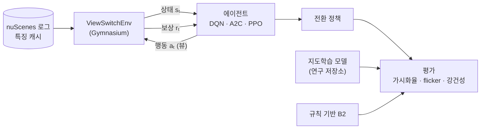

<div align="center">

# 🎛️ RL Camera View Switching

**원격주행 관제를 위한 강화학습 기반 카메라 뷰 전환 정책**


> 매 순간 "가장 중요한 뷰"를 고르는 것과, **화면을 너무 자주 바꾸지 않으면서** 위험을 놓치지 않는 것은 다른 문제입니다.<br/>
> 뒤쪽 문제를 순차 의사결정으로 보고, 강화학습으로 전환 정책을 학습합니다.

</div>

> [!NOTE]
> 🚧 **계획 단계입니다.** 아직 코드가 없고, 이 README는 프로젝트 설계서입니다.
> [Adaptive-Camera-View-Selection-System](https://github.com/cbnu-yhjeon/Adaptive-Camera-View-Selection-System)(지도학습 모델)의 후속 실험입니다.

---

## 📌 문제 정의

연구 저장소의 지도학습 모델은 프레임마다 최적 뷰를 예측하고, 화면 깜빡임(flicker)은 손실 함수의 temporal consistency 항으로 억제합니다.
하지만 "지금 바꾸면 2초 뒤 더 위험한 객체를 놓칠 수 있다" 같은 **장기적인 득실**은 프레임 단위 분류로 직접 최적화되지 않습니다.

## 💡 핵심 아이디어: 로그로 정확하게 재생되는 MDP

뷰 선택은 **오퍼레이터가 무엇을 보는지만 바꾸고, 차량과 주변 세계에는 영향을 주지 않습니다.** 그래서 주행 로그만으로 환경을 정확히 재현할 수 있습니다.

| 요소 | 정의 |
|---|---|
| 상태 `sₜ` | 주행 컨텍스트 `xₜ`(채널별 영상 특징, 위험도 벡터, CAN) + 직전 뷰 `vₜ₋₁` + 마지막 전환 후 경과 시간 |
| 행동 `aₜ` | 보조(attention) 뷰 6채널 중 하나. 주 뷰(진행 방향)는 연구 저장소처럼 고정 |
| 전이 | `xₜ₊₁`은 로그에서 그대로 읽음(행동과 무관), `vₜ = aₜ` |
| 보상 `rₜ` | `Σ_{i ∈ view(aₜ)} w(TTCᵢ)  −  λ_sw · 1[aₜ ≠ vₜ₋₁]  −  λ_miss · 1[TTC < 3 s인 객체가 화면 밖]` |

- 세계의 전이가 행동과 무관하므로, 로그 재생 환경에서의 온라인 RL이 **시뮬레이터 오차 없이** 성립합니다.
- 전환 비용 `λ_sw`가 0이면 문제는 매 프레임 독립적인 선택(contextual bandit)이 됩니다. **RL이 의미를 갖는 지점은 전환 비용이 있을 때**입니다. 이 점을 실험으로 보여 줍니다.

---

## 🔗 기반 수업과 저장소

| 수업 / 프로젝트 | 가져올 것 | 저장소 |
|---|---|---|
| 강화학습 | MDP · 벨만 방정식, DQN(Experience Replay, Target Network), Policy Gradient, A2C | [Reinforcement-Learning-Entities](https://github.com/cbnu-yhjeon/Reinforcement-Learning-Entities) |
| 연구: 적응형 카메라 뷰 | nuScenes 특징 캐시, TTC 가중치 `w(TTC)`, 의사 라벨, scene 분할, 평가 지표, 노이즈 강건성 프로토콜 | [Adaptive-Camera-View-Selection-System](https://github.com/cbnu-yhjeon/Adaptive-Camera-View-Selection-System) |
| 딥러닝 실체 | 신경망 학습 원리 | [Deep-Learning-Entities](https://github.com/cbnu-yhjeon/Deep-Learning-Entities) |

---

## 🧭 접근 방법



1. **환경 구현:** 연구 저장소의 특징 캐시를 읽는 `ViewSwitchEnv`를 Gymnasium 인터페이스로 만듭니다. 에피소드 하나는 scene 하나(약 20초)입니다.
2. **에이전트:** 이산 행동이라 DQN을 먼저 쓰고, A2C와 PPO를 비교합니다. 상태 인코더는 연구 저장소의 경량 Transformer 구조를 재사용합니다.
3. **지도학습으로 초기화 (선택):** 지도학습 모델 가중치로 정책을 초기화해 학습 시간을 줄입니다.

---

## 🗂️ 데이터

| 데이터 | 용도 | 비고 |
|---|---|---|
| [nuScenes](https://www.nuscenes.org/) + CAN bus | 환경 로그 | 연구 저장소의 특징 캐시 재사용 |
| 연구 저장소 골드셋 | 최종 평가 | 사람이 검수한 뷰 라벨 |

> 학습 · 검증 · 시험은 연구 저장소의 scene 분할(70/15/15)을 그대로 씁니다. nuScenes는 **CC BY-NC-SA 4.0**입니다.

---

## 🧪 실험 설계

| ID | 정책 | 목적 |
|:---:|---|---|
| B1 | 고정 전방 | 하한선 |
| B2 | 규칙 기반 (TTC 최대 채널, 연구 저장소와 동일) | 근시안적 기준선 |
| SUP | 지도학습 모델 (연구 저장소) | 현재 최선 |
| RL-0 | DQN, `λ_sw = 0` | bandit과 같아지는지 확인 |
| RL-1 | DQN, `λ_sw` 여러 값 | 가시화율과 flicker의 **파레토 곡선** |
| RL-2 | A2C · PPO | 알고리즘 비교 |
| RL-N | RL-1을 노이즈 위험도 입력으로 학습 | 강건성 |

### 지표 (연구 저장소와 동일 정의)

- **위험 객체 가시화율:** TTC < 3 s인 GT 객체가 선택한 뷰 화각 안에 있었던 비율
- **Flicker rate:** 전환 후 1.5초 안에 다시 전환한 비율
- **Top-1 / Top-2:** 골드셋 기준
- **누적 보상**, **강건성:** 노이즈 유형(miss · FP · 위치 노이즈 · 채널 드롭) × 강도별 성능 저하 곡선

---

## 🗓️ 마일스톤

| 주차 | 내용 | 산출물 |
|:---:|---|---|
| 1 | `ViewSwitchEnv` 구현, B1 · B2 재현 | 환경 단위 테스트 |
| 2 | DQN, RL-0 | bandit 동등성 확인 |
| 3 | `λ_sw` 스윕 | 파레토 곡선 |
| 4 | A2C · PPO | 알고리즘 비교표 |
| 5 | 노이즈 강건성 실험 | 성능 저하 곡선 |
| 6 | 지도학습 모델과 종합 비교, 정리 | 최종 보고서 |

## 📁 디렉토리 구조 (계획)

```
RL-Camera-View-Switching/
├── configs/
├── src/
│   ├── env/            view_switch_env.py (Gymnasium)
│   ├── agents/         dqn.py · a2c.py · ppo.py
│   ├── encoders/       연구 저장소의 상태 인코더
│   └── eval/           가시화율 · flicker · 강건성
├── tests/              환경 전이·보상 단위 테스트
├── results/
└── README.md
```

## ⚠️ 리스크와 대응

| 리스크 | 대응 |
|---|---|
| 보상 설계가 평가 지표를 그대로 베끼면 순환 평가가 됨 | 주 지표는 골드셋 Top-1/2, 보상과 다른 지표를 함께 보고 |
| scene이 짧아(약 20초) 장기 효과가 작을 수 있음 | 연속 scene을 이어 붙인 긴 에피소드 실험 추가 |
| RL 학습이 불안정함 | 고정 seed 여러 개로 반복, 지도학습 초기화 |

## 📚 참고 자료

- V. Mnih et al., *Human-level control through deep reinforcement learning* (DQN), Nature 2015
- V. Mnih et al., *Asynchronous Methods for Deep Reinforcement Learning* (A3C/A2C), ICML 2016
- J. Schulman et al., *Proximal Policy Optimization Algorithms*, 2017
- [Gymnasium](https://gymnasium.farama.org/)
